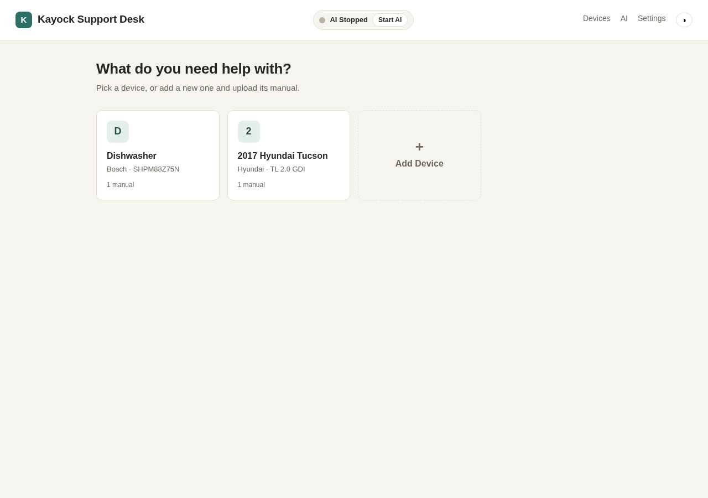
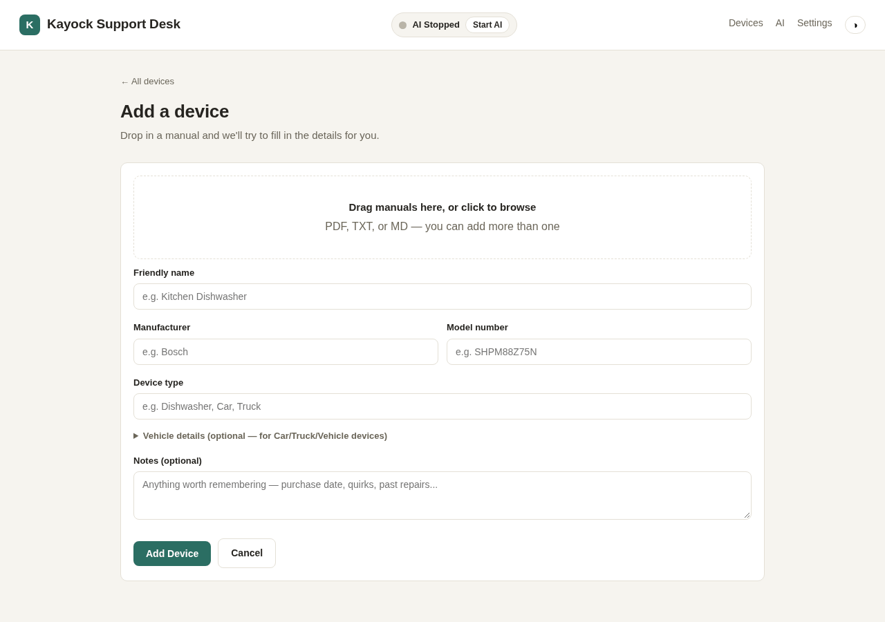
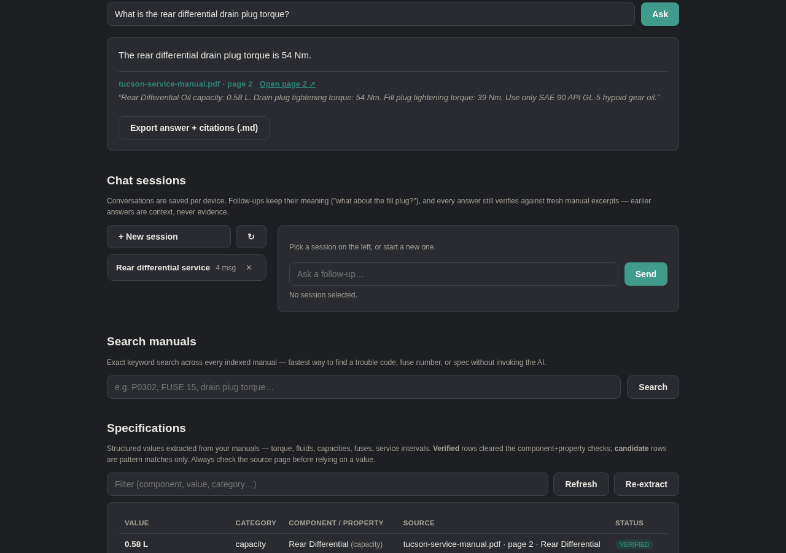
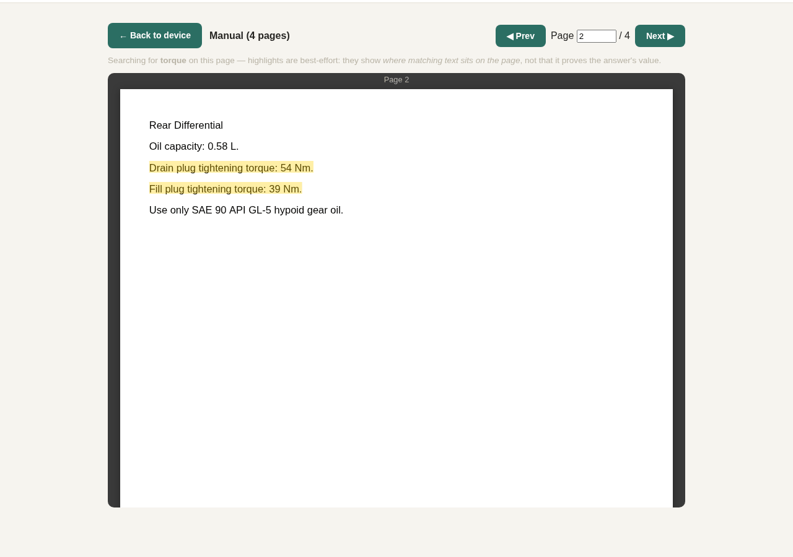
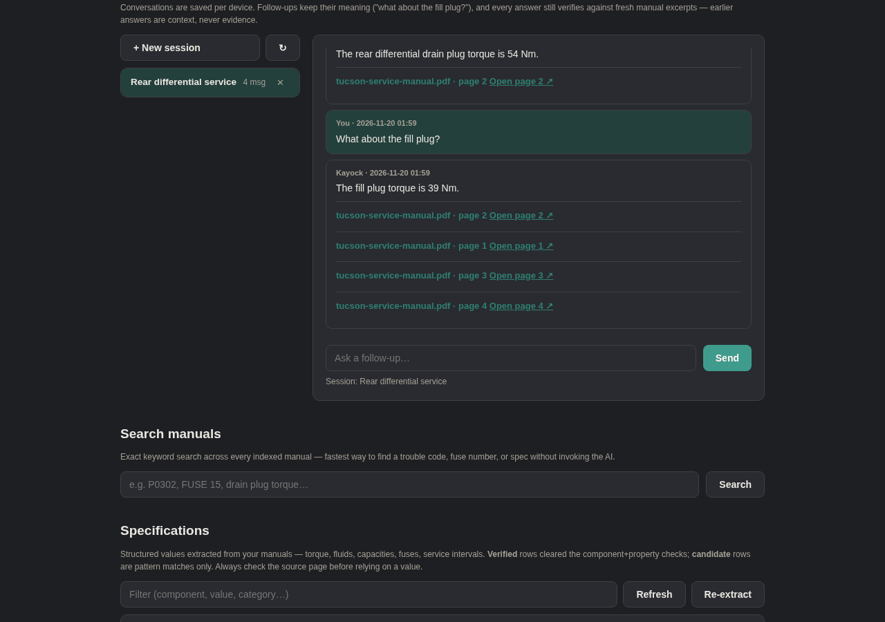
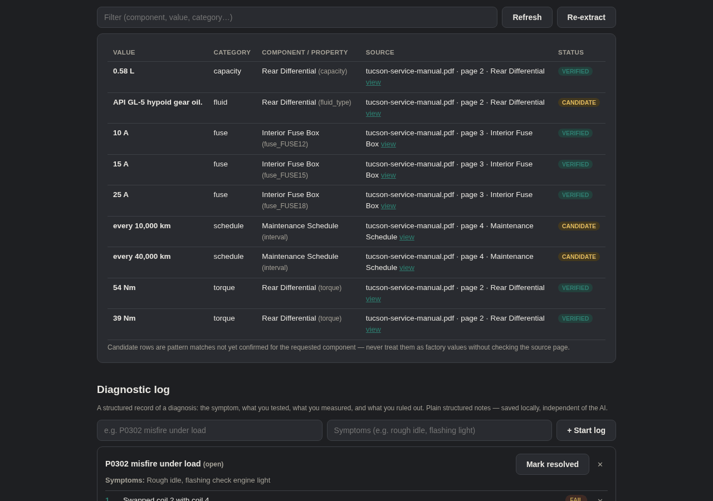
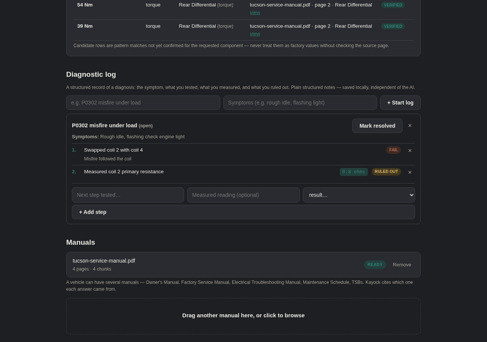
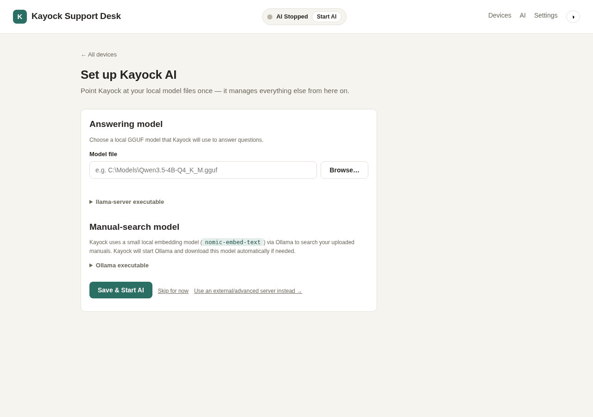
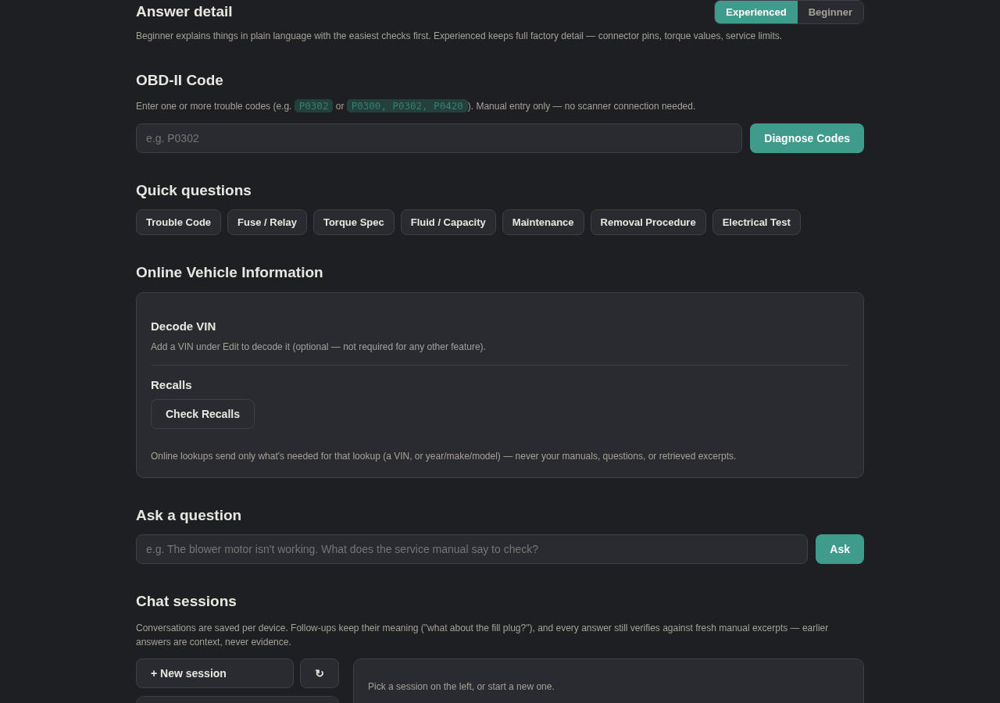
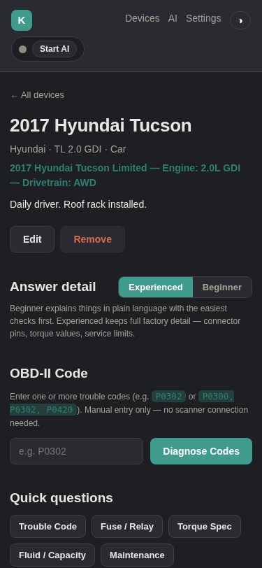

# Kayock Support Desk

**A local-first technical manual and diagnostic assistant for your devices and vehicles.**

Upload a manual once, then ask plain-language questions and get answers pulled straight from the
document — with the source page shown, the section named, and exact specifications verified
against the text before they're offered.

> "What does error E24 mean?" → answered from your Bosch dishwasher's manual, with the page it came from.
> "Rear differential drain plug torque?" → `54 Nm`, cited to *tucson-service-manual.pdf, page 2, "Rear Differential"* — with a click-to-page viewer.

Runs entirely on one computer on your home network: no cloud account, no subscription, and your
manuals never leave your machine (see [Privacy](#privacy-and-network-behavior)).

---

## Screenshots

| | |
|---|---|
| [](docs/screenshots/01-dashboard.png) | [](docs/screenshots/02-device-library.png) |
| *01 — The Support Desk dashboard: your device library at a glance.* | *02 — Adding a device: plain details, optional vehicle profile.* |
| [](docs/screenshots/03-technical-answer.png) | [](docs/screenshots/04-pdf-viewer.png) |
| *03 — Source-backed answer with citation and "Open page 2" link.* | *04 — Local PDF viewer (bundled pdf.js, no CDN) at the cited page.* |
| [](docs/screenshots/05-conversation.png) | [](docs/screenshots/06-specifications.png) |
| *05 — Saved chat sessions: follow-ups keep meaning, evidence stays fresh.* | *06 — Structured specifications: verified vs. candidate, always with sources.* |
| [](docs/screenshots/07-diagnostics.png) | [](docs/screenshots/08-ai-settings.png) |
| *07 — Diagnostic log: symptoms, tested steps, readings, ruled-out causes.* | *08 — Kayock AI setup: pick a GGUF file once, Kayock manages the rest.* |
| [](docs/screenshots/09-dark-mode.png) | [](docs/screenshots/10-mobile.png) |
| *09 — Dark mode follows the OS or a manual toggle.* | *10 — Responsive layout on a phone-sized screen (375 px).* |

---

## What it does

- **Answers from your manuals, not the internet.** Retrieval finds relevant passages in your
  uploaded manuals (hybrid semantic + keyword search), and the local language model answers
  using only those excerpts. If the documents don't contain enough information, it says so.
- **Verifies exact specifications.** For torque/capacity/fuse-style questions, two verification
  layers check that a passage is actually about the requested *component* and that the requested
  *property* is backed by a number near its name — so a mounting-bolt torque is never reported
  as the drain-plug torque.
- **Shows its sources.** Every answer carries citations (document, page, section) that open the
  bundled PDF viewer at the cited page with best-effort text highlighting. Highlights show where
  text sits on the page — they never by themselves prove a value.
- **Keeps structured data.** Specifications are extracted into searchable tables
  (verified vs. candidate), troubleshooting conversations are saved per device, and a structured
  diagnostic log records symptoms, tested steps, measured readings, and ruled-out causes.
- **Runs your local AI for you.** Kayock launches and manages `llama-server` (GGUF) and Ollama
  (embeddings), or you can point it at any external OpenAI-compatible server.

## Feature overview

- Windows, Linux (Ubuntu-first), and macOS launchers; fully local operation
- Hybrid retrieval: SQLite FTS5/BM25 keyword search fused with Chroma semantic search (RRF),
  plus exact-phrase/OBD-code reranking
- Section- and table-aware PDF chunking (headings, fuse tables, page/section attribution)
- Per-device saved chat sessions with configurable history budget; fresh evidence every turn
- Structured diagnostic log (LLM-independent, plain local data)
- Structured specifications: torque, fluids, capacities, fuses, service intervals
- Persistent background job queue: indexing progress, retries, cancellation, crash recovery
- Click-to-page PDF viewer with bundled pdf.js (works fully offline)
- Dark mode, compact technician layout, keyboard navigation, answer export
- Installable PWA with an honest offline story (cached pages are labeled; live AI is never faked)
- Optional OCR for scanned PDFs (see [Manual formats](#supported-manual-formats-and-optional-ocr))
- Online VIN decode and NHTSA recall lookups (optional, off-able — see [Privacy](#privacy-and-network-behavior))

## Installation and startup

**Requirement for all platforms:** Python 3.10 or newer
([python.org/downloads](https://www.python.org/downloads/)). The launchers check and tell you if
it's missing. The first run creates a virtual environment and installs the Python requirements —
one or two minutes, once.

### Windows

1. Unzip the project folder anywhere.
2. Double-click **`Start-Windows.bat`**.
3. A browser tab opens at `http://localhost:8765` when the server is ready.

### Linux (Ubuntu first)

1. Install the system packages (one time):

   ```bash
   sudo apt install python3 python3-venv python3-pip
   ```

   Optional: `sudo apt install python3-tk` enables native Browse… dialogs.
2. Run **`./Start-Linux.sh`** in a terminal.
3. Check your environment any time with `python doctor.py` (human-readable, exit-code-friendly)
   or `python doctor.py --json`.

Full guide — including headless servers, optional OCR, systemd skeleton, and troubleshooting —
is in [docs/LINUX_SETUP.md](docs/LINUX_SETUP.md).

### macOS

1. Unzip the project folder.
2. Double-click **`Start-Mac.command`**. If Gatekeeper blocks the first open: right-click the
   file → **Open** → **Open**.
3. A browser tab opens when the server is ready.

The server listens on all interfaces, so phones/tablets on the same network can open the URL
shown in Settings (a QR code is generated there too).

## Local AI configuration

Kayock manages local model processes so you never type ports or model IDs:

- **Managed (default):** on the first-run **Set up Kayock AI** screen, click **Browse…** and pick
  a GGUF chat model file, then **Save & Start AI**. Kayock launches `llama-server` for that model
  on a port it picks, waits until it can answer, starts (or connects to) Ollama for embeddings,
  makes sure `nomic-embed-text` is available, and shows **🟢 AI Ready**. Your model path is
  remembered; later runs just click **Start AI** (or use the navbar widget).
  - You need a **GGUF chat model** anywhere on disk and **llama-server** on PATH (or set its path
    in the setup screen's advanced disclosure), plus [Ollama](https://ollama.com) installed.
  - **CPU-only builds work identically** — no GPU flags are assumed. To pass flags explicitly
    (e.g. `--n-gpu-layers 99`), use **Settings → Advanced AI Settings → Managed model launch
    options**: a configurable context window (`llm_context_size`, default unchanged at 4096 —
    raisable, never silently reduced) and extra llama-server arguments.
- **External / Advanced:** point Kayock at any OpenAI-compatible server (LM Studio, vLLM, a
  llama-server on another box, Ollama's `/v1` endpoint) under **Settings → Advanced AI
  Settings**. With this mode, prompts and questions are sent to *that* server — Kayock is only
  as local as the endpoints you configure.
- **No chat model configured?** You can still add devices and upload manuals; indexing and Q&A
  show a clear "AI needs attention" state instead of a confusing error. If the embedding backend
  is down, questions degrade to keyword-only retrieval and still answer from your manuals.
- For development and demos without downloading models:
  `python scripts/fake_model_server.py` provides a tiny OpenAI-compatible stand-in
  (documented in the script header).

## Supported manual formats and optional OCR

- **PDF (with a text layer)**, `.txt`, and `.md` files, up to 100 MB each.
- AES-encrypted "restrict-editing" PDFs (common for factory manuals) open fine; PDFs that
  genuinely require a password are rejected with a clear message.
- **Scanned/image-only PDFs** are rejected with an actionable error unless you install the
  optional OCR pieces — then they index like any other PDF:

  ```bash
  sudo apt install tesseract-ocr        # the OCR engine
  .venv/bin/pip install -r requirements-ocr.txt
  ```

  Nothing here is mandatory: without these pieces everything else works as before.

## Hybrid search and citation verification

Every question runs **two** retrievals and fuses them:

1. **Semantic** — Chroma vector search over embedded chunks.
2. **Keyword** — SQLite **FTS5** (BM25) over a text mirror of every chunk, with an automatic
   LIKE fallback when a SQLite build lacks FTS5.

The ranked lists merge by reciprocal rank fusion, then an exact-phrase/OBD-code reranker runs on
top. This is what makes `P0302`, `FUSE 15`, or an exact part name reliably find the right passage.
The device page also has a **Search manuals** box (`GET /api/devices/{id}/search`) for exact
lookups without invoking the model at all.

For exact-spec questions, the pipeline verifies before it offers: component verification (is this
passage about the requested component?) then property verification (is the requested property
backed by a number near its name?). Only passages clearing both are used as citation sources for
an exact value; unverified values are answered with an explicit "could not verify" statement, and
candidates in the specifications table are labeled as such. Deeper design notes: the old
in-project operations write-up is preserved at [docs/OPERATIONS.md](docs/OPERATIONS.md).

## Vehicle diagnostics and structured specifications

- Mark a device as a vehicle to get an OBD-II code panel (manual code entry — no scanner
  connection), year/make/model/engine/drivetrain context in prompts, and Beginner/Experienced
  answer detail.
- **Structured specifications** are extracted at index time into searchable tables — torque,
  fluid types, capacities, fuse ratings (including fuse-table rows keyed by fuse id), and service
  intervals — each row keeping its document, page, section, and excerpt. Rows are **verified**
  only when the same evidence bar as exact-spec answers is met; everything else stays a
  **candidate**. Nothing is invented, averaged, or silently blended.
- With several manuals for one device, results prefer documents matching the configurable
  `spec_document_preference` keywords (service > owner by default); every row still shows where
  it came from.

## Conversations and diagnostic history

- **Chat sessions** are saved per device in SQLite with every answer's citations. Follow-ups keep
  conversational meaning ("what about the fill plug?") — the retrieval query is resolved via the
  previous turn — while retrieval and verification always run fresh on the current question, and
  the prompt marks history as context-only, never citable evidence. The history budget
  (`chat_history_max_messages`, default 8) bounds the model's framing, not your retrieval.
- **Diagnostic log** records a troubleshooting session as structured data: title, symptoms,
  ordered steps with what you did, the measured reading, and a result (pass / fail / ruled out),
  plus an outcome. It's deliberately independent of the AI — a technician's notebook that
  survives restarts.

## Privacy and network behavior

- **Local-first:** manuals, the database, vector and keyword indexes, chat history, and logs all
  live under `data/` on your machine. There are no accounts, no telemetry, and no built-in
  cloud service.
- **Your manuals stay private.** Document contents are only ever sent to the AI endpoints *you*
  configure. With the default managed mode, that means local `llama-server` and Ollama on the
  same machine. If you configure an external server, you are choosing to send prompts (including
  retrieved excerpts) to it — Kayock does not claim offline operation in that case.
- **Optional online lookups are clearly separated.** VIN decoding (NHTSA vPIC) and recall checks
  (NHTSA) are behind a master Settings toggle plus per-feature toggles; when enabled they send
  only the minimum identifier (a VIN, or year/make/model) — never your manuals, questions, or
  retrieved excerpts. Generic OBD-II code meanings come from a bundled offline dictionary, no
  network needed.
- The server binds to your network interface so phones can reach it; anything on your LAN can
  open it (home-network trust model — see [SECURITY.md](SECURITY.md)).

## Known limitations and troubleshooting

- **Single background worker:** many large manuals index one at a time (tracked, retryable, and
  restart-safe via the job queue — just not parallel).
- **OCR is optional** and quality depends on Tesseract; clean scans work best.
- **Home-network trust model:** Kayock has no built-in authentication — it is designed for your
  LAN, not for exposure to the internet. Don't port-forward it.
- **OBD-II is manual code entry** — no scanner adapter ships with the project (the adapter
  interface exists in `app/services/extensions/obd.py` for future work, and nothing pretends a
  scanner is connected when it isn't).
- **No GPU is required or assumed;** large models on CPU can be slow. Lower-quantization GGUF
  files help.
- **Troubleshooting:** the **AI page** shows component status with hints; **Settings → System
  diagnostics** snapshots Python/venv, data-folder writability, file-picker availability,
  llama-server/Ollama discovery, and GPU presence (informational only); logs live in
  `data/logs/` (`app.log`, `chat_server.log`, `embedding_server.log`); `python doctor.py`
  checks the same things from the terminal. On Linux, see
  [docs/LINUX_SETUP.md §8](docs/LINUX_SETUP.md#8-troubleshooting).

## Testing

```bash
python3 -m venv .venv
source .venv/bin/activate          # Windows: .venv\Scripts\activate
pip install -r requirements-dev.txt -r requirements-ocr.txt
python -m pytest -q                # full offline suite (no models needed)
python scripts/smoke_test.py       # end-to-end: real server process + fake model server
```

The pytest suite runs fully offline (LLM/embedding calls are deterministic fakes). The smoke
test starts the real application, seeds a manual through the real upload/index pipeline,
exercises search, specs, chat sessions, the viewer, restart persistence, and clean shutdown,
using the bundled fake model server.

## Contributing

Contributions are welcome! See [CONTRIBUTING.md](CONTRIBUTING.md) for development setup, how to
run the tests, and what makes a good pull request. Please read
[CODE_OF_CONDUCT.md](CODE_OF_CONDUCT.md) before participating.

## License and acknowledgments

Kayock Support Desk is released under the [MIT License](LICENSE).

The bundled PDF.js viewer is Mozilla's pdfjs-dist, distributed under the Apache-2.0 license
(its unmodified license text is preserved at
`app/static/vendor/pdfjs/LICENSE.pdfjs.txt`). Python packages are installed separately at
runtime and keep their own licenses. Model weights, manuals, and user data are never bundled.
Full details in [THIRD_PARTY_NOTICES.md](THIRD_PARTY_NOTICES.md).

*The copyright holder line in `LICENSE` ("Kayock Support Desk project contributors") is a
placeholder pending confirmation by the project owner.*
